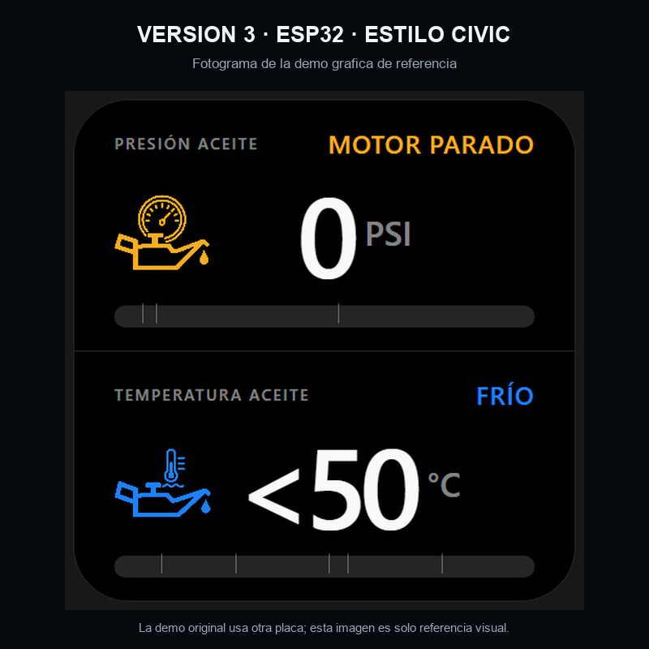

# Medidor HELLA para ESP32 · interfaz Civic

Carpeta separada para la variante que mantendrá el sensor HELLA y adoptará una presentación gráfica inspirada en la demo Civic.

La animación completa se conserva como [`reference/demo-civic.gif`](reference/demo-civic.gif). Es una referencia visual del proyecto Civic original, diseñado para otro hardware; **no es el firmware de este medidor ni una prueba sobre GC9B72**. La adaptación del lector HELLA y el firmware ESP32 aún no están incluidos en esta carpeta.

Los recursos Civic de referencia están sujetos a la licencia no comercial y al aviso de copyright del autor que se adjuntan aquí: [`LICENSE.md`](LICENSE.md) y [`NOTICE`](NOTICE). No distribuyas esta variante ni la uses comercialmente fuera de los términos de la licencia; para otros usos se requiere autorización del titular.
