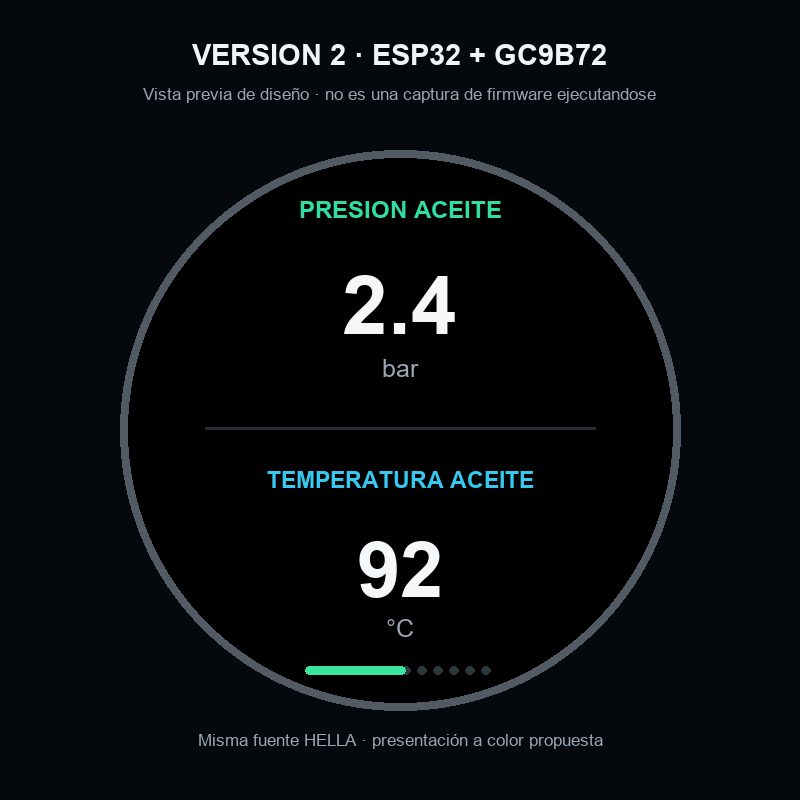

# Medidor HELLA para ESP32-WROOM y GC9B72

Variante separada prevista para conservar las lecturas del sensor HELLA y mostrarlas en una TFT circular GC9B72 de 360×360 por SPI.

**Estado:** esta carpeta contiene la maqueta de interfaz y la especificación del objetivo; todavía no incluye firmware ESP32 completo ni una captura de la pantalla ejecutándose. La maqueta no debe usarse como evidencia de compilación o prueba física.

La secuencia de lectura PWM y sus fórmulas deben portarse desde el sketch Arduino. El diseño eléctrico para conectar la salida del sensor al ESP32, la protección automotriz y la calibración de ADC requieren definición y comprobación antes de conectarlo al coche.
