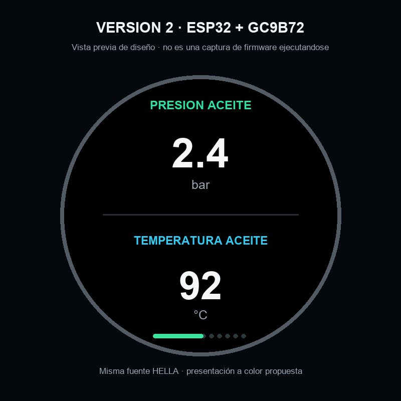
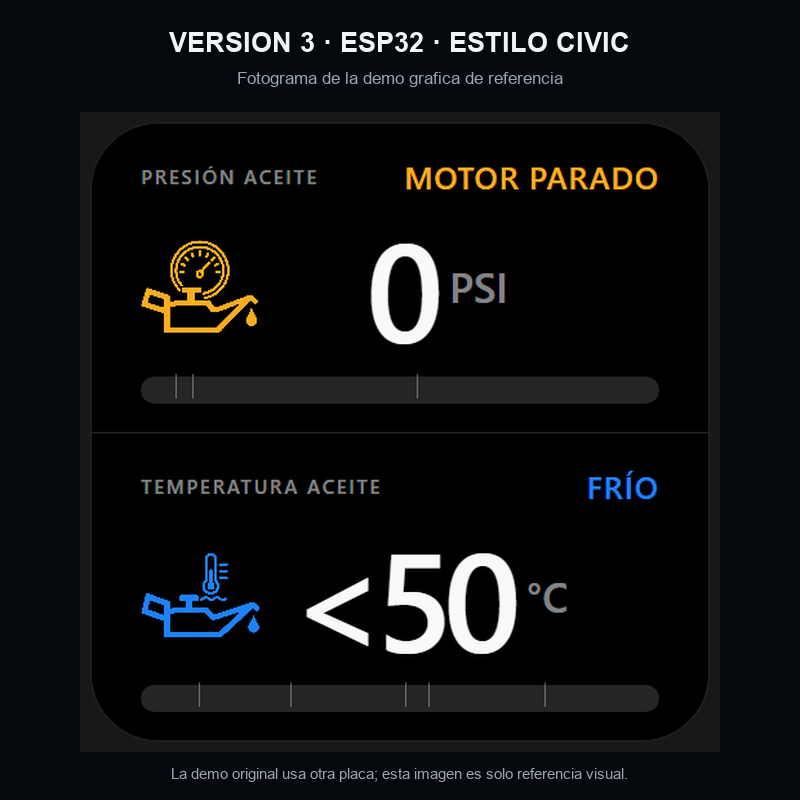

# Medidor de aceite HELLA · tres variantes

Fork en español del medidor que utiliza el sensor **HELLA 6PP 010 378-101**. Los proyectos están separados por placa e interfaz:

1. [`Arduino/MedidorAceiteArduino`](Arduino/MedidorAceiteArduino/README.md) — sketch Arduino original, OLED monocroma 128×64.
2. [`ESP32/MedidorAceiteESP32`](ESP32/MedidorAceiteESP32/README.md) — adaptación prevista a ESP32-WROOM y pantalla GC9B72 a color 360×360.
3. [`ESP32/MedidorAceiteESP32-Civic`](ESP32/MedidorAceiteESP32-Civic/README.md) — variante visual separada, con la interfaz inspirada en el medidor Civic.

## Comparación visual

### 1 · Arduino original

Reconstrucción ampliada a partir de las coordenadas del sketch, no fotografía física.

### 2 · ESP32 GC9B72

Maqueta de presentación para la pantalla redonda; no es una captura de firmware ejecutándose.

### 3 · ESP32 con estética Civic

Fotograma de la demo gráfica de referencia; no representa firmware adaptado o probado en la GC9B72. La demo y los recursos gráficos se identifican con su licencia y aviso dentro de la carpeta.

La animación de referencia completa está en [demo-civic.gif](ESP32/MedidorAceiteESP32-Civic/reference/demo-civic.gif).

## Montaje Arduino del autor

El video del autor muestra la alimentación desde el encendido del coche mediante un convertidor DC-DC de 12 V a 5 V en **4:22**, y la caja abierta, el Arduino Nano y el cableado en **6:48**.

- [Alimentación (4:22)](https://youtu.be/Wn5kIrU5_tc?t=262)
- [Caja y cableado (6:48)](https://youtu.be/Wn5kIrU5_tc?t=408)
- [Video completo](https://youtu.be/Wn5kIrU5_tc)

La miniatura enlaza al video original; no se presenta como foto propia del equipo terminado.
