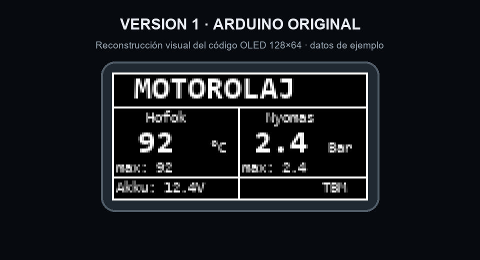
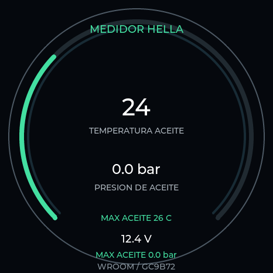
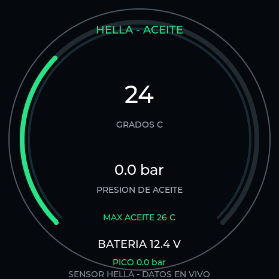

# Medidor de aceite HELLA · tres variantes

Fork en español del medidor que utiliza el sensor **HELLA 6PP 010 378-101**. Los proyectos están separados por placa e interfaz:

1. [`Arduino/MedidorAceiteArduino`](Arduino/MedidorAceiteArduino/README.md) — sketch Arduino original, OLED monocroma 128×64.
2. [`ESP32/MedidorAceiteESP32`](ESP32/MedidorAceiteESP32/README.md) — firmware ESP-IDF para ESP32-WROOM/GC9B72 con el medidor clásico.
3. [`ESP32/MedidorAceiteESP32-Civic`](ESP32/MedidorAceiteESP32-Civic/README.md) — segundo firmware ESP-IDF para el mismo sensor y pantalla, con interfaz deportiva independiente.

## Comparación visual

### 1 · Arduino original

Reconstrucción ampliada a partir de las coordenadas del sketch, no fotografía física.

### 2 · ESP32 GC9B72 clásico

Captura de la interfaz renderizada por el mismo código LVGL del firmware, dentro del simulador de PC.

### 3 · ESP32 estilo deportivo

Segunda interfaz y firmware independientes, también renderizados por el simulador con el código LVGL de esta variante.

## Montaje Arduino del autor

El video del autor muestra la alimentación desde el encendido del coche mediante un convertidor DC-DC de 12 V a 5 V en **4:22**, y la caja abierta, el Arduino Nano y el cableado en **6:48**.

- [Alimentación (4:22)](https://youtu.be/Wn5kIrU5_tc?t=262)
- [Caja y cableado (6:48)](https://youtu.be/Wn5kIrU5_tc?t=408)
- [Video completo](https://youtu.be/Wn5kIrU5_tc)

La miniatura enlaza al video original; no se presenta como foto propia del equipo terminado. Las dos variantes ESP32 incluyen fuentes, capturas simuladas y firmware compilado para WROOM/GC9B72. Aún falta validar físicamente la pantalla, el sensor y el acondicionamiento eléctrico antes de conectarlos al coche.
